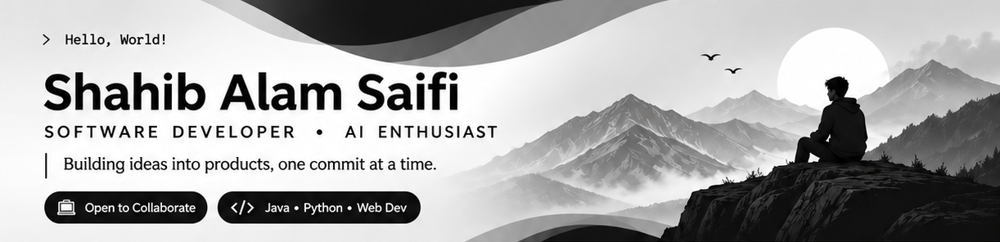

  

<table>
<tr>
<td width="52%" valign="top">

## 👤 About Me

I'm a Software Engineering student passionate about Data Structures & Algorithms, Web Development, and Artificial Intelligence.

I enjoy building projects, learning new technologies, and solving real-world problems.

**Currently focused on:**
- Java and Data Structures & Algorithms
- Python programming
- AI-powered applications
- Full-stack web development
- Open-source collaboration

*Shahib Alam Saifi*

</td>
<td width="48%" valign="top">

## `</>` Tech Stack

</td>
</tr>
</table>

---

## ▥ GitHub Statistics

  

  

---

## 🚀 Featured Projects

<table>
<tr>
<td width="33%" valign="top">

### 📁 Log-LenX

**Intelligent Log Analysis**

A log-analysis prototype that groups similar application logs into prioritized incidents to help developers investigate problems faster.

`React` `TypeScript` `Node.js`

[Explore Project →](https://github.com/Shahib-Alam-Saifi/Log-LenX)

[Live Demo →](https://log-lenx.vercel.app/)

</td>

<td width="33%" valign="top">

### 📁 TraceMind

**AI Incident Investigation**

An AI-powered debugging platform using persistent memory to recall historical incidents and previously confirmed solutions.

`Next.js` `TypeScript` `AI`

[Explore Project →](https://github.com/Shahib-Alam-Saifi/TraceMind)

[Live Demo →](https://tracemind-3tvdfok0o-editorxp1-alts-projects.vercel.app/)

</td>

<td width="33%" valign="top">

### 📁 Open Source

**Open-Locker**

Open-source collaboration on a platform for public lockers and shared infrastructure.

`GitHub` `Community`

[Explore Project →](https://github.com/Open-Locker/Open-Locker)

</td>
</tr>
</table>

---

<table>
<tr>
<td width="50%" valign="top">

## 🤝 Let's Connect

Feel free to reach out, collaborate or just say hi!

</td>

<td width="50%" valign="middle" align="center">

### *“Consistency builds great developers.”*

— Shahib Alam Saifi

</td>
</tr>
</table>

 

<b>BUILD · LEARN · CONTRIBUTE</b>

